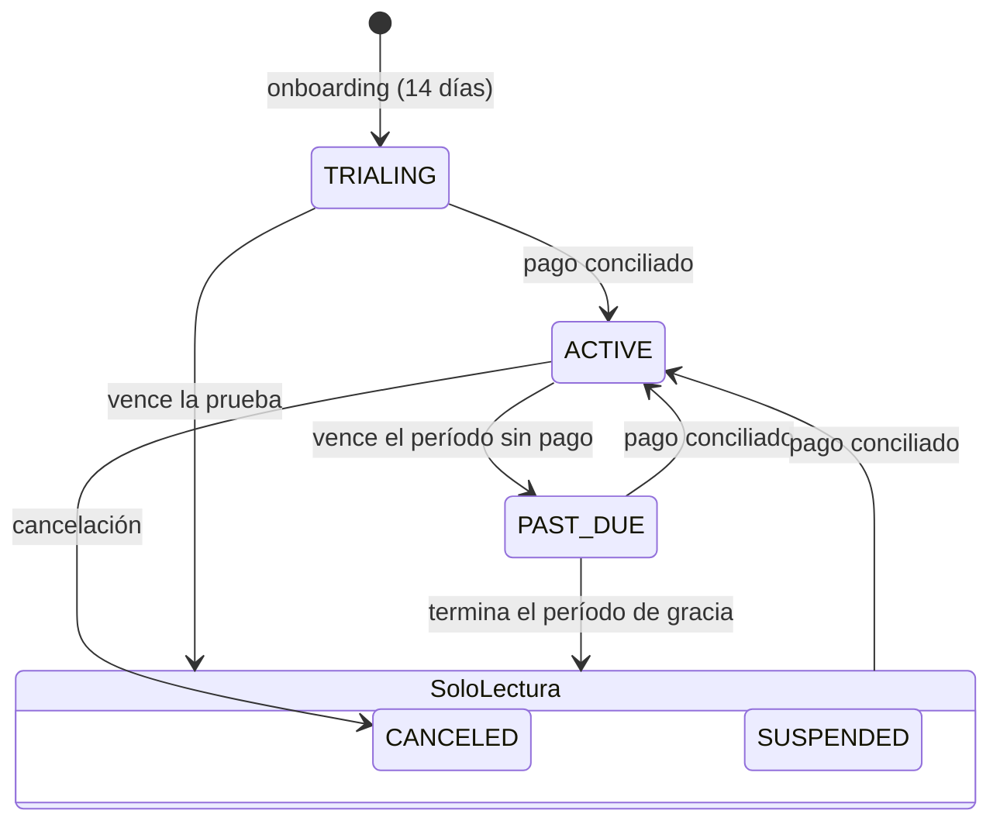

# Estrategia de facturación del SaaS

> Estado (v0.8.0): planes, prueba, límites en backend y **cobro manual con conciliación** implementados
> (§4.1). Ningún proveedor de pago (pasarela) está integrado ni contratado; no se procesan pagos en línea.

## 1. Planes (precios de EJEMPLO, editables por la plataforma)

| Plan | Sucursales | Usuarios | Incluye | Precio de ejemplo |
|---|---|---|---|---|
| Básico | 1 | 2 | Catálogo, movimientos, lotes, vencimientos, reportes esenciales | 15,00 USD/mes |
| Profesional | 3 | 10 | + compras, transferencias, alertas, reportes avanzados | 39,00 USD/mes |
| Empresarial | por contrato | por contrato | + permisos avanzados, auditoría ampliada, API futura, soporte prioritario | a convenir |

Los precios viven en la tabla `plans` (solo la plataforma puede modificarlos, por RLS). La moneda y las
condiciones de cobro (impuestos, retenciones, moneda de pago) son preguntas abiertas (Q-BIL-1..3).

## 2. Entitlements

- `maxUsers` cuenta **membresías activas + invitaciones vigentes**; `maxBranches` cuenta sucursales activas.
- `Subscription.max*_override` permite límites por contrato (Empresarial).
- Se validan **siempre en el servidor**, dentro de la transacción y con un candado por empresa
  (`pg_advisory_xact_lock`) para que solicitudes concurrentes no superen el límite. También al aceptar una
  invitación y al reactivar un miembro. Evidencia: `tests/integration/entitlements.test.ts`.
- Las funciones por plan (`plans.features`) se verificarán con el mismo patrón al implementar compras,
  transferencias y alertas.

## 3. Estados de suscripción



| Estado | Acceso |
|---|---|
| TRIALING (vigente), ACTIVE, PAST_DUE dentro de gracia | completo |
| TRIALING vencido, PAST_DUE tras gracia, SUSPENDED, CANCELED | **solo lectura**: se puede consultar y exportar, no modificar |

**Nunca se borran datos por impago.** Política de retención propuesta: datos conservados al menos 12 meses
tras la cancelación con exportación disponible; luego borrado previa notificación (Q-BIL-4). Downgrade: si el
uso supera el nuevo límite, no se borra nada; se bloquean nuevas altas hasta quedar dentro del límite (el
propietario puede desactivar miembros, operación permitida aun en modo solo lectura).

## 4. Proveedores de cobro

```ts
interface BillingProvider {
  id: "manual" | string;
  createCheckout?(subscriptionId: string, plan: Plan): Promise<{ url: string }>;
  handleWebhook?(rawBody: string, signature: string): Promise<BillingEvent>; // firmado e idempotente
}
```

### 4.1 Manual con conciliación (predeterminado para Venezuela)

1. La empresa elige plan y medio de pago (transferencia, pago móvil u otros aceptados por la entidad comercial).
2. Registra el pago con referencia y comprobante (archivo aislado por empresa).
3. Un operador de plataforma con permiso de facturación **concilia** contra el extracto y aprueba; la
   suscripción pasa a ACTIVE con `current_period_end`. Todo queda auditado; aprobación de montos altos con
   doble control.
4. Recordatorios antes del vencimiento; período de gracia configurable.

### 4.2 Pasarela internacional (p. ej. Stripe)

Solo si la **entidad comercial** que vende el servicio está constituida en un país elegible para la pasarela
(verificar la lista oficial vigente del proveedor). Webhooks verificados con firma, procesados una sola vez
(tabla de eventos con id único) y conciliados con el estado local.

### 4.3 Proveedores locales

Sujetos a validación técnica, legal y de seguridad antes de integrarse; mismo contrato `BillingProvider`.

## 5. Métricas para el panel superadmin (Fase 4)

MRR (suma de suscripciones ACTIVE normalizadas a mensual), churn mensual, conversiones de prueba, empresas en
gracia, uso por empresa (usuarios, sucursales, productos). El panel muestra **metadatos**, nunca inventarios.


## 6. Implementación del cobro manual (v0.8.0)

- Tabla `payments` (RLS): la empresa solo **inserta** pagos `PENDING` y ve los suyos; solo la plataforma
  (`app.platform_admin`) los aprueba o rechaza. Un trigger impide modificar un pago ya revisado o borrar pagos.
  Restricción `reviewed_by_id <> submitted_by_id` (nadie concilia lo que registró). Referencia única por empresa y medio.
- Registrar un pago está permitido en modo solo lectura (para reactivar la cuenta). Pagos en Bs. se convierten
  con la tasa que la empresa registró para la fecha del pago; si no hay tasa, el operador lo ve.
- Aprobar: plan = el pagado; `ACTIVE`; `current_period_end` = fin vigente (o hoy si venció) + meses.
  Tras el fin del período hay **7 días de gracia** y luego solo lectura (`subscriptionAccessMode`).
- Panel `/plataforma`: SUPERADMIN gestiona; SUPPORT solo consulta. Rol asignado por `PLATFORM_SUPERADMIN_EMAILS`
  al desplegar; MFA obligatorio. El rol se verifica en la base de datos en cada operación.
- Evidencia: `tests/integration/billing.test.ts`, `apps/web/e2e/comercializacion.spec.ts`.
