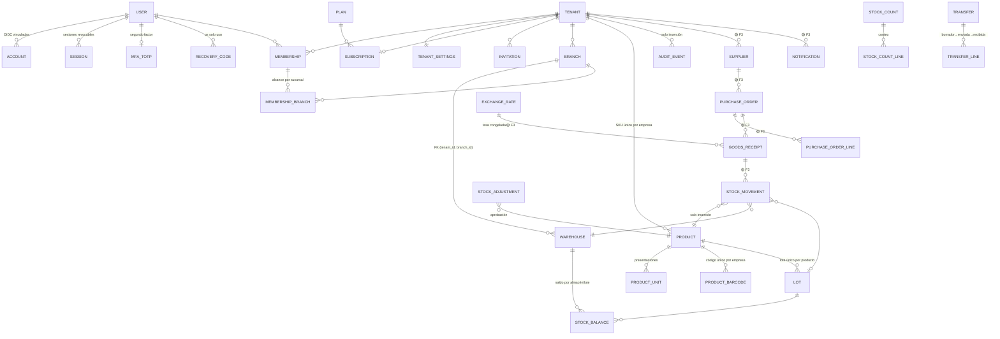

# Modelo de datos

Fuente de verdad: [`packages/db/prisma/schema.prisma`](../packages/db/prisma/schema.prisma) y las migraciones en
[`packages/db/prisma/migrations`](../packages/db/prisma/migrations). Este documento resume relaciones,
restricciones e invariantes. Leyenda: ✅ implementado (Fase 1) · 🟡 diseñado, se implementa en la fase indicada.

## 1. Diagrama entidad-relación

## 2. Tablas implementadas (Fase 1)

| Tabla | Ámbito | RLS | Notas |
|---|---|---|---|
| `users` | global | no (autorización en servidor) | correo único en minúsculas (CHECK); `platform_role`; `disabled_at` |
| `accounts`, `verification_tokens` | global | no | Auth.js (OIDC y enlace mágico; el token se guarda con hash por Auth.js) |
| `sessions` | global | no | sesión en BD; `mfa_verified_at`, `active_tenant_id`, `last_seen_at` |
| `mfa_totp` | por usuario | **sí** (usuario dueño o superadmin) | secreto cifrado AES-256-GCM; `last_used_step` (anti-replay); bloqueo |
| `recovery_codes` | por usuario | **sí** | HMAC-SHA256 con pimienta; `used_at` |
| `rate_limit_buckets` | global | no | ventana fija atómica |
| `plans` | plataforma | **sí** (lectura libre, escritura solo plataforma) | precios de ejemplo; límites `max_users`, `max_branches` (null = contrato) |
| `tenants` | empresa | **sí** | visible si es el contexto, si el usuario es miembro activo o para la plataforma; sin DELETE |
| `tenant_settings` | empresa | **sí** | es-VE, America/Caracas, moneda base, MFA para todos, stock negativo, umbral de aprobación |
| `memberships` | empresa | **sí** | único (tenant, user); el usuario ve sus propias membresías |
| `membership_branches` | empresa | **sí** | sin filas = todas las sucursales |
| `invitations` | empresa | **sí** | token solo como SHA-256; visible al correo destinatario |
| `subscriptions` | empresa | **sí** | la empresa la crea en onboarding y la lee; **solo la plataforma la modifica** |
| `branches`, `warehouses` | empresa | **sí** | código único por empresa; FK compuesta almacén→sucursal |
| `products` | empresa | **sí** | SKU único por empresa; **sin DELETE** (se inactiva) |
| `audit_events` | empresa / null | **sí** | solo INSERT/SELECT para `rc_app` + trigger que rechaza UPDATE/DELETE/TRUNCATE |

## 3. Invariantes garantizadas por la base de datos

1. **Sin datos huérfanos de empresa**: `tenant_id NOT NULL` en todas las tablas de empresa (salvo auditoría de
   cuenta/plataforma, `tenant_id` null intencional).
2. **Sin documentos cruzados entre empresas**: las relaciones internas usan FK compuestas `(tenant_id, id)`
   (p. ej. `warehouses (tenant_id, branch_id) → branches (tenant_id, id)`). Probado en
   `tests/integration/tenant-isolation.test.ts`.
3. **Unicidad por empresa**: `UNIQUE (tenant_id, sku)`, `UNIQUE (tenant_id, code)` en sucursales y almacenes.
4. **Historial no se borra**: sin privilegio DELETE en `products` ni en `audit_events`; `tenants` sin política DELETE.
5. **Auditoría inmutable**: trigger `app.reject_mutation()`.
6. **Correos normalizados**: CHECK `email = lower(email)` en `users` e `invitations`.
7. **Planes coherentes**: precio ≥ 0, límites > 0 o null.

## 4. Diseño de las fases siguientes (para revisión)

### Fase 2 — Inventario como libro (✅ implementado en v0.4.0; diseño original abajo)

Tablas: `product_units`, `product_barcodes`, `lots`, `stock_movements` (solo inserción + trigger),
`stock_balances` (`lot_key` = coalesce(lot_id, uuid cero) para unicidad con "sin lote"), `idempotency_keys`,
`stock_adjustments`, `stock_counts`, `stock_count_lines`, `transfers`, `transfer_lines`. Todas con RLS forzado.
Invariantes adicionales en BD: trigger `app.assert_lot_matches` (un lote referenciado pertenece a la misma
empresa y producto), CHECK de cantidades (≠ 0, > 0, contado ≥ 0), unidad base válida, vencimiento ⇒ lotes,
transferencia entre almacenes distintos. Diferencias respecto del diseño: las reservas existen como campo pero
sin flujo aún; el vencimiento se evalúa por fecha (zona de la empresa) en cada operación en lugar de un job.

- `product_units (tenant_id, product_id, unit_code, factor_to_base DECIMAL(20,6), dimension)` con validación
  dimensional (masa, volumen, longitud, unidad). Conversión solo dentro de la misma dimensión; factores exactos.
- `product_barcodes (tenant_id, code)` único por empresa; tipo EAN-13/UPC-A/interno con dígito verificador.
- `lots (tenant_id, product_id, lot_number, supplier_id?, manufactured_at?, received_at, expires_at?, unit_cost, status)`;
  estados: disponible, reservado, cuarentena, vencido, dañado, retirado, agotado.
- `stock_movements` **solo inserción** (mismo patrón que auditoría): tipo (recepción, salida, transferencia
  salida/entrada, ajuste, merma, devolución, reverso, conteo), cantidad DECIMAL(20,6) en unidad base, unidad y
  cantidad originales, costo unitario, moneda, referencia de documento, actor, motivo, `reverses_movement_id`.
- `stock_balances (tenant_id, warehouse_id, product_id, lot_id)` con `on_hand`, `reserved`; actualización en la
  misma transacción que el movimiento mediante `UPDATE … SET on_hand = on_hand - $q WHERE … AND on_hand - reserved >= $q`
  (no negativos sin carrera); política `allow_negative_stock` + permiso especial para excepciones.
- `idempotency_keys (tenant_id, key, request_hash, response, created_at)` `UNIQUE (tenant_id, key)`: la segunda
  petición con la misma clave devuelve el resultado original y no duplica stock.
- FEFO: `ORDER BY expires_at ASC NULLS LAST, received_at ASC, lot_id ASC` (desempate determinista), excluyendo
  estados no despachables y lotes vencidos a la fecha de Caracas.
- Valoración (separada de FEFO físico): costo promedio ponderado por (empresa, producto) por defecto; FIFO
  contable como opción documentada.
- `stock_counts` / `stock_count_lines`: conteo físico o cíclico; la diferencia genera movimientos de ajuste con
  motivo y, sobre el umbral de `tenant_settings`, aprobación de un segundo usuario distinto del solicitante.

### Fase 3 — Compras y moneda (✅ implementado en v0.5.0)

Tablas: `suppliers`, `exchange_rates` y `goods_receipts`/`goods_receipt_lines` (solo inserción + trigger),
`tax_rates`, `purchase_orders`, `purchase_order_lines`, `notifications` (RLS por empresa y por usuario).
Trigger genérico `app.assert_ref_same_tenant` para referencias simples (proveedor preferido, orden, tasa,
línea de orden, movimiento). Numeración correlativa por empresa con candado transaccional.

Diseño original:

- `suppliers` (RIF opcional validado por formato), `purchase_orders` (borrador, aprobada, parcialmente
  recibida, recibida, cancelada), `purchase_order_lines`, `goods_receipts` con líneas por lote.
- `exchange_rates (scope: plataforma | empresa, base, quote, rate DECIMAL(20,8), effective_at, source, fetched_at, created_by)`;
  cada documento guarda `exchange_rate_id` **y** el valor de la tasa usada (snapshot).
- `notifications` + `notification_deliveries` con clave de deduplicación por (empresa, lote, umbral).

## 5. Tipos numéricos

| Uso | Tipo | Regla |
|---|---|---|
| Cantidades | `DECIMAL(20,6)` | precisión según unidad; validación de decimales permitidos por unidad |
| Costos unitarios | `DECIMAL(20,6)` | sin redondeo intermedio |
| Importes de documento | `DECIMAL(20,2)` | redondeo `ROUND_HALF_UP` al cerrar el documento (configurable, ver preguntas abiertas) |
| Tasas de cambio | `DECIMAL(20,8)` | se guarda la tasa tal como la publica la fuente |
| Precios de planes | `DECIMAL(18,2)` | implementado |
